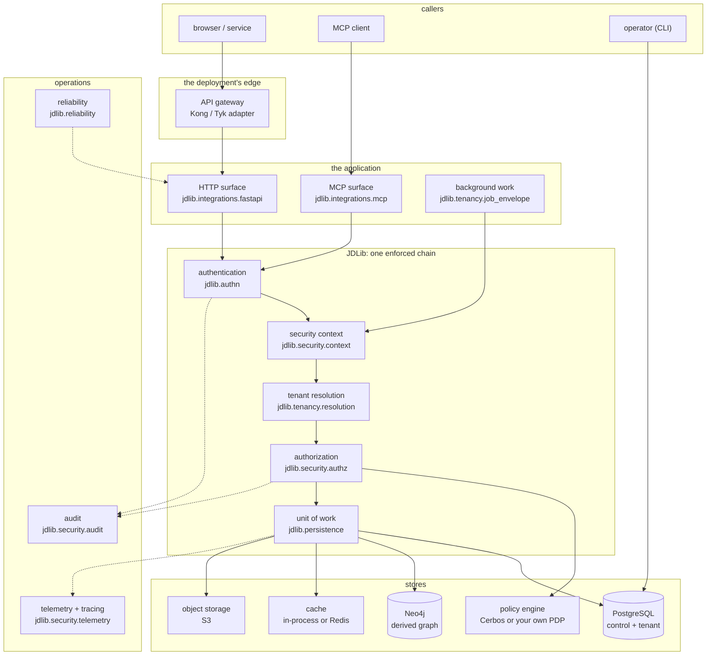

# High-level architecture

JDLib is a library that sits inside an application's request path, between the transport that
accepted the request and the database that will answer it. It owns five decisions and delegates
everything else.

## What the library owns

1. **The credential.** Which methods exist, how each is verified, and what a failure means.
   `jdlib.authn` (API keys, OIDC) composed by `jdlib.authn.wiring.build_authenticator`.
2. **The identity the rest of the request sees.** `SecurityContext`, bound for the request and
   readable through `jdlib.current_context()` / `current_tenant()`. Nothing downstream re-derives it.
3. **The tenant.** Which tenant the caller belongs to, decided by a configured resolver order, and
   verified against the tenant's lifecycle state by `ContextFactory`.
4. **The authorization decision.** `jdlib.security.authz.pep` puts the declared permission to a
   decision point *before* the handler runs, and treats a degraded answer as a refusal.
5. **The data boundary.** The unit of work is tenant-bound, and the database enforces it as well:
   row-level security with the application role (`jdlib.persistence.session`, `JDLIB_RLS__APP_ROLE`).

## What it deliberately does not own

| Not owned | Whose it is | Where that is stated |
|---|---|---|
| policy content | yours — any PDP that answers the library's question | [`docs/security/authorization-hardening.md`](../security/authorization-hardening.md) |
| the gateway's own protections | the deployment's edge; the library reads what it asserts | [`docs/security/gateway-hardening.md`](../security/gateway-hardening.md) |
| the queue | the deployment's; `jdlib.tenancy.job_envelope` gives work authority and a lifetime, not delivery | [`features/jobs`](../jdlib/features/jobs.md) |
| provisioning | an operator command (`jdlib db upgrade-control`, `jdlib tenant …`) | [`production-readiness`](../jdlib/production-readiness.md) |
| the graph's content | yours — the library gives the plane a tenant and a closed query vocabulary | [`features/graph`](../jdlib/features/graph.md) |

## The boundaries, in one line each

* **Process boundary:** everything in the diagram runs in the application's process except the
  policy engine, the stores and the collector.
* **Trust boundary:** the credential is untrusted until `jdlib.authn` has verified it; the resolved
  tenant is trusted because it came from the verified context, never from a request field.
* **Data boundary:** the tenant plane is a schema (or a shared schema with RLS) that the application
  role cannot cross; the control plane holds no tenant data.
* **Evidence boundary:** audit records what was *decided* and who asked; telemetry records what was
  *done* and how long it took, with an attribute allow-list deciding what may leave the process.
