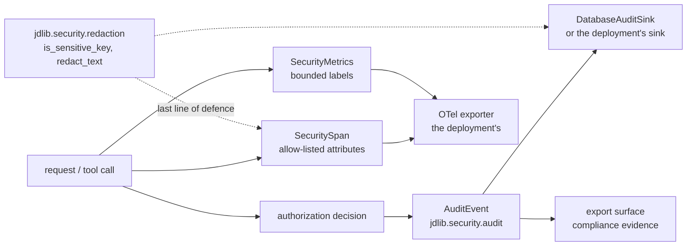

# Observability architecture

Three signals, one rule: **nothing leaves the process that has not been allow-listed.** Telemetry is
useful exactly to the degree that it can be trusted not to carry a secret or a tenant's data.

## The signals

| Signal | Module | What it carries | What it must not carry |
|---|---|---|---|
| traces | `jdlib.security.tracing` (`SecuritySpan`, `security_span`, `TracerLike`) | request ids, the route, the decision, the outcome, durations | arguments, credentials, tenant data |
| metrics | `jdlib.security.telemetry` (`SecurityMetrics`, `safe_emit`) | counters and durations keyed by bounded labels | high-cardinality or caller-controlled labels (`MetricLabelError` refuses them) |
| audit | `jdlib.security.audit` (`emitter`, `emitters`, `events`, `access`) | who asked, what was decided, for which tenant, when | the data the operation touched |

## The allow-list is the design

`jdlib.security.tracing` carries an explicit allow-list of span attributes: an attribute not on it is
dropped rather than exported. That is a stronger rule than "do not log secrets", because it does not
depend on every future caller remembering it — a new attribute is invisible until someone adds it
deliberately. The metrics side has the same posture: `MetricLabelError` refuses a label that is not
bounded, so a tenant slug or an identifier cannot become a metric dimension by accident.

## Audit as evidence

The audit vocabulary is written for the *decision*, not for the data: an event names the principal,
the action, the tenant, the outcome and the request identity, and it is written whether the outcome
was an allow or a refusal. Two sinks ship — the database sink and an in-memory one for tests — and the
compliance surface reads them through `jdlib.security.audit.export` and
`jdlib.security.compliance.evidence`.

A denial writes to the audit plane from both surfaces: the MCP boundary writes three events for a
refused tool call (the call, the decision, the outcome) where the HTTP path writes one — a difference
the enterprise example asserts rather than glosses, because it is a real difference in what an
incident can reconstruct.

## What an incident reads

| Question | Where the answer is |
|---|---|
| was the request authenticated, and as whom? | the audit event's principal and method |
| which tenant, and how was it resolved? | the audit event's tenant, the resolver named in the span |
| was it allowed, and by what? | the decision event: allowed, denied, or degraded |
| did the handler run? | the span's outcome plus the audit event — a denial has no handler span |
| was the dependency healthy? | the breaker's state transition metrics and `/readyz` |
| was anything dropped? | the exporter's own counters, plus the audit sink's failure metric |

## The redaction floor

`jdlib.security.redaction.is_sensitive_key` and `redact_text` are the last line of defence: they run
over a record before it is emitted, so a value that reached a log line despite the allow-list is
still replaced. They are a floor, not the design — the design is that the attribute never qualified
in the first place.
