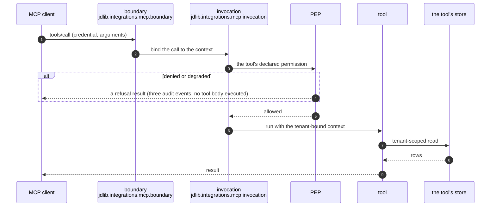

# Request lifecycle

Two entry points, one chain. This page follows a single HTTP request and a single MCP tool call
through the same collaborators, and names what each step refuses.

## HTTP

```mermaid
sequenceDiagram
    autonumber
    participant C as caller
    participant MW as middleware<br/>jdlib.integrations.fastapi
    participant A as authenticator<br/>jdlib.authn.composite
    participant F as ContextFactory<br/>jdlib.tenancy
    participant P as PEP<br/>jdlib.security.authz.pep
    participant H as handler
    participant U as unit of work<br/>jdlib.persistence.uow
    participant DB as PostgreSQL

    C->>MW: GET /api/me (credential)
    MW->>MW: request ids, deadline, security headers
    MW->>A: authenticate(credential)
    alt credential is not valid
        A-->>C: 401 UNAUTHENTICATED (envelope, audited)
    end
    A-->>MW: SecurityContext (principal, method, tenant claim)
    MW->>F: resolve tenant + verify lifecycle
    alt tenant is suspended or unknown
        F-->>C: 403 / 404 (envelope, audited)
    end
    F-->>MW: bound context (contextvar)
    MW->>P: is_allowed(subject, permission, resource)
    alt decision is deny, or the engine is unreachable
        P-->>C: 403 AUTHORIZATION_DENIED (audited; the handler never ran)
    end
    P-->>MW: allowed
    MW->>H: call the handler
    H->>U: tenant-bound session
    U->>DB: statement with the tenant scope + RLS
    DB-->>U: rows (the tenant plane only)
    U-->>H: entities
    H-->>C: 200 (envelope)
```

The steps that matter most are the ones that *stop*: an invalid credential is refused before the
tenant is resolved, a suspended tenant is refused before authorization, and a denial is refused
before the handler is entered — which is why the security layer measures denial as non-execution,
with an allowing control beside it so a test cannot pass by refusing everything.

## MCP



A tool's advertised schema is the schema the library enforces: the arguments are validated against
the declared input model before the tool body runs, and an unregistered resource URI is a refusal
rather than a crash. The enterprise example asserts both, and the MCP surface's denials write the
same audit vocabulary as the HTTP surface's.

## Background work

A job carries a *signed envelope* rather than a context: `jdlib.tenancy.job_envelope` gives it the
tenant, the principal and an expiry, and the worker verifies the signature before binding it. A job
that outlives its envelope is refused rather than executed with stale authority — the same rule as a
request, applied to a unit of work that has no request around it.

## What each step is allowed to assume

| Step | Assumes | Never assumes |
|---|---|---|
| middleware | nothing about the credential | that the caller sent a tenant |
| authenticator | the credential's shape for its method | that the claims are true until verified |
| context factory | the tenant id is well-formed | that the tenant is active |
| PEP | the context is bound | that the policy engine is reachable |
| handler | its declared permission was enforced | that the session is unscoped |
| unit of work | the context's tenant | that a query names the tenant itself |

The last row is the reason for row-level security: the session is tenant-scoped *and* the database
enforces the scope, so a query that forgot its predicate returns nothing rather than another
tenant's rows.
