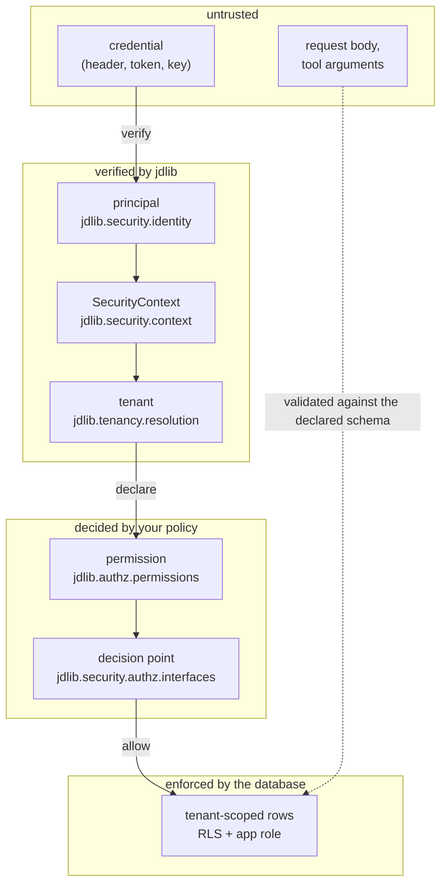

# Security architecture

The library's security claim is narrow and testable: **every entry point runs the same chain, and
each step refuses rather than degrades.** This page names the boundaries, the enforcement points, and
what each one does when its dependency is unavailable.

## The boundaries

Three of those arrows are one-way on purpose: a request field never becomes a tenant, a caller never
becomes a principal without verification, and an unreachable engine never becomes an allow.

## The enforcement points

| Point | Module | What it refuses |
|---|---|---|
| transport | `jdlib.security.responses`, `jdlib.integrations.fastapi` | an oversized or malformed request; one error envelope for every failure |
| credential | `jdlib.authn.composite`, `jdlib.authn.apikey`, `jdlib.authn.oidc` | an unverifiable credential — `401`, and the failure is audited |
| context | `jdlib.security.context` | a context built from an unverified source; the envelope's signature is checked |
| tenant | `jdlib.tenancy.resolution`, `ContextFactory` | an unknown tenant (`404`), a suspended one (`403`) |
| authorization | `jdlib.security.authz.pep` | a denied permission, and a *degraded* decision — an unreachable engine is a refusal, not a pass |
| data | `jdlib.persistence.session`, `strategies.rls` | a query that would cross the tenant boundary |
| graph | `jdlib.graph.tenant`, `jdlib.graph.query` | a session without a tenant; an identifier that is not a value |
| secret handling | `jdlib.credentials.redaction`, `jdlib.security.redaction` | a secret in a log line, a span attribute, or a cache entry |
| egress | `jdlib.security.tracing` | any attribute not on the span allow-list |

## The three rules that make the chain hold

1. **One source for the tenant.** `SecurityContext` is the only place a tenant is recorded; a header,
   a query parameter or a body field that claims one is ignored. The enterprise example asserts this
   in `examples/enterprise/tests/security/test_tenant_isolation.py`.
2. **Denial is non-execution.** The PEP runs before the handler or the tool body. The security suite
   measures a denial as *the body not having run*, with an allowing control in the same test.
3. **A degraded dependency is a refusal.** An unreachable policy engine, an unverifiable JWKS, an
   unparseable context envelope: each answers the canonical error and writes an audit event, rather
   than falling back to a permissive default.

## What the library does not defend against

| Not covered | Why, and where it is stated |
|---|---|
| a compromised host | the library runs in your process; host integrity is the deployment's |
| a gateway that asserts a false identity | `jdlib.security.gateway` reads what the edge asserts — the edge must be trusted, and `docs/security/gateway-hardening.md` says which headers and why |
| a policy that is wrong | the engine decides; the library makes the decision uniform, not correct |
| an operator with database access | the control plane is operator API by design; the owner role can read the tenant plane |
| side channels in your own handlers | the library bounds the surface, not your business logic |

## Evidence

Every claim above is held by a suite: `tests/unit/security/` for the core,
`examples/enterprise/tests/security/` for the composed chain against real PostgreSQL, Cerbos and
Neo4j, and the adversarial review's findings in
[`docs/security/adversarial-review.md`](../security/adversarial-review.md) — including the defects it
found, which are recorded with the row that names them.
