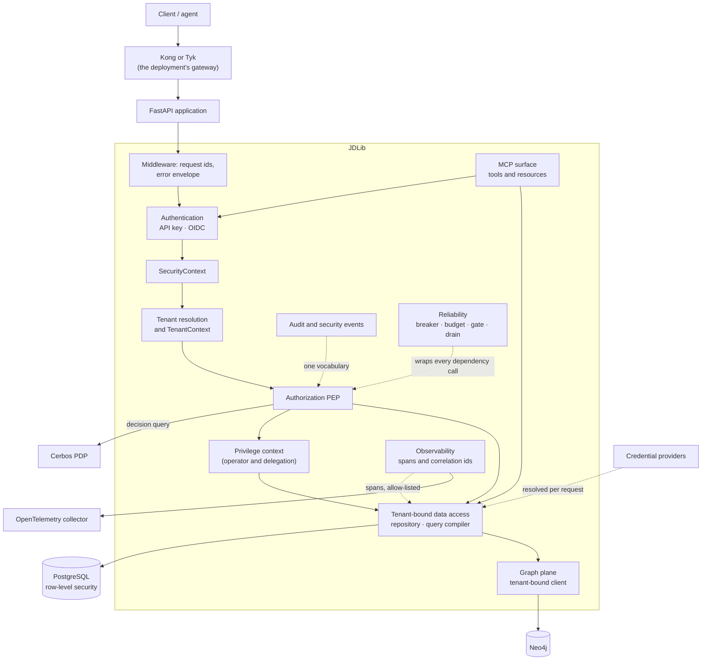

# JDLib

A multi-tenant security foundation for applications that put PostgreSQL and Neo4j behind one
enforced surface: authentication, tenant resolution, authorization, audit, reliability and
observability, each with the tests that hold it in place.

This site is the reference for the library as it is implemented today. It is built from the
repository's own documents - the design authorities are linked, not copied - and it is validated in
the same gate as the code: `mkdocs build --strict` fails the build on a broken link, a missing page
or a stale inventory, and `tests/unit/test_docs_portal.py` checks the navigation and every diagram.

!!! note "An internal library"
    JDLib is not a hosted service and this site claims no public URL. Read it as the engineering
    reference for a library you deploy inside your own application.

## Start where you are

| If you are… | Read | What you get |
|---|---|---|
| **new to JDLib** | [Introduction](getting-started/introduction.md) · [Quickstart](getting-started/quickstart.md) | the problem it solves, how to install it, and the first application that is *correct* rather than merely running |
| **an application developer** | [Features](jdlib/features/README.md) · [Examples](jdlib/examples/overview.md) | one page per feature: when to use it, when not to, and the seam that does the work |
| **an architect** | [Architecture](architecture/long-form-reference.md) · [Design documents](jdlib/07-implementation-design.md) | the boundaries, the components, and what belongs inside the library rather than beside it |
| **a security engineer** | [Security](security/README.md) · [Threat model](threat-model/README.md) | the controls, the failures they answer, and the residual risk that stays yours |
| **an operations engineer** | [Operations](operations/README.md) · [Production readiness](jdlib/production-readiness.md) | readiness, degradation, and what a deployment has to do that a library cannot |

## The whole surface at a glance

Every box in that diagram is a page in this site, and every arrow is a test somewhere in the
repository. The ones that matter most:

* **the tenant comes from the credential**, never from a request field - the resolver chain decides
  it, and a header claiming otherwise is ignored ([Tenancy](jdlib/features/tenancy.md));
* **authorization runs before the handler**, and a degraded policy engine refuses rather than
  allowing ([Authorization](jdlib/features/authorization.md));
* **the database enforces the same rule** as the repository, so a forgotten filter is a refused read
  rather than a disclosure ([Row-level security](jdlib/03-isolation-invariants.md));
* **one error envelope** answers every failure, and a 5xx never echoes its own text
  ([Error responses](security/error-responses.md)).

## The library in one paragraph

A request arrives with a credential. JDLib verifies it, resolves the tenant it belongs to, builds a
`SecurityContext` that the rest of the request reads, and asks a policy engine whether this
principal may take this action on this target. If the answer is yes, the operation runs inside a
tenant-bound session whose statements the database itself constrains; if it is no, the operation
never runs and the refusal is recorded. Everything that happened on the way - the decision, the
privileged read, the export - is written to one audit vocabulary, and the spans that carry the
request's ids never carry its values.

## Where the documentation lives

| Section | What it is |
|---|---|
| [Getting started](getting-started/introduction.md) | installation, configuration, the first application |
| [Concepts](jdlib/architecture.md) | the design authorities: what each mechanism is for |
| [Architecture](architecture/long-form-reference.md) | the long-form reference and the request/security flows |
| [Features](jdlib/features/README.md) | one guide per feature, in the directive's template |
| [Capabilities](jdlib/capabilities/README.md) | one page per capability, machine-checked against the tree |
| [Examples](jdlib/examples/overview.md) | the minimal and enterprise applications, and what running them found |
| [Security](security/README.md) | the hardening programme, the threat model and the compliance surface |
| [Operations](operations/README.md) | readiness, degradation, and the operator's own job |
| [Development](development/documentation.md) | how this documentation is organised and validated |
