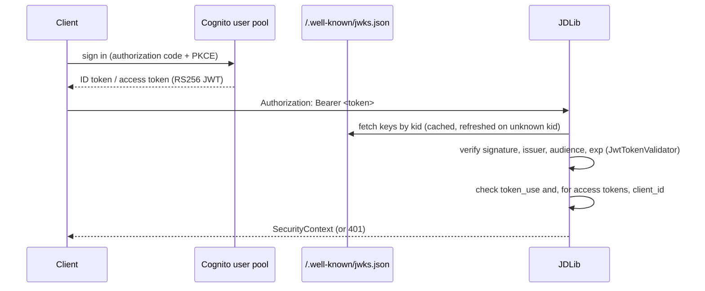

# Authentication with Amazon Cognito

> **Design authority:** [the AWS capability matrix](aws-capability-matrix.md) and
> [the research sources](research-sources.md). Where this page and AWS documentation disagree, AWS
> documentation wins and this page is wrong.

## What it is

An `Authenticator` for Amazon Cognito user pools. `security/authn/cognito.py` supplies Cognito
discovery — issuer, JWKS location, audience and the algorithm allow-list — to the library's existing
provider-neutral `JwtTokenValidator`, and adds the one check that validator does not make: the
`token_use` claim.

## Why it exists

A Cognito user pool is an OIDC identity provider, so the library does not need a second JWT
implementation to accept its tokens; it needs the pool's coordinates and the two Cognito facts that
differ from other providers. AWS documents token verification as the application's job and
recommends a JWT library — so the adapter is configuration and discovery, and signature validation
stays in the one place that already does it.

## When to use it

When the identity provider is a Cognito user pool and the application is JDLib. When the provider is
ZITADEL, use `security/authn/zitadel.py`; the two are wired the same way and nothing in the core
changes.

## When not to use it

Do not use it as an authorization mechanism. Cognito authenticates and issues tokens; it has no
policy language, no resource-level decisions and no tenancy model. Authorization belongs to the
[policy decision point](authorization-verified-permissions.md).

## How it works

The generic validator checks signature, issuer, audience and time claims. The adapter adds
`validate_cognito_token`, which rejects a token whose `token_use` is not the type the deployment
expects — the two token types carry different claims *and* are signed by different key pairs, so a
token of the wrong type is rejected rather than reinterpreted.

## What Cognito provides, and what it does not

| Cognito provides | Cognito does not provide |
| --- | --- |
| A user directory and an OIDC/OAuth2 identity provider | Any policy language or resource-level authorization decision |
| RS256 JWT access and ID tokens with a published JWKS | A tenancy model: multi-tenancy is an application (and policy-store) design choice |
| Group membership (`cognito:groups`) and OAuth scopes | Nested groups: groups are flat and name-keyed |
| Refresh-token revocation and global sign-out | Revocation that a JWT check can see — revoked user-pool tokens still pass signature and expiry checks in any JWT library, so the documented mitigation is short token lifetimes |
| Key rotation | A published clock-skew tolerance for application-side validation |
| MFA, including TOTP | Application permissions: a group's only permission mechanism is an IAM role consumed through identity pools |

## Configuration

| Setting | Default | Notes |
| --- | --- | --- |
| `issuer` | required | `https://cognito-idp.{region}.amazonaws.com/{pool_id}`; https only |
| `audience` | required | the app client ID |
| `region`, `user_pool_id` | unset | when set, both are validated against the issuer |
| `algorithms` | `("RS256",)` | Cognito signs RS256; the library's allow-list rejects symmetric algorithms |
| `token_use` | `"id"` | the token type the deployment expects on the wire |
| `jwks_ttl` | 1 hour | key-cache lifetime; an unknown `kid` forces a refresh |
| `leeway` | **0 seconds** | AWS documents no skew tolerance for user-pool validation; ZITADEL's default is a minute, and this difference is deliberate |
| `timeout` | 5 seconds | JWKS fetch timeout |

The audience claim depends on the token type, and that is why the default is `id`: an ID token
carries `aud` (the app client ID) which the generic validator can check, while an access token
carries `client_id` and only carries `aud` when a resource binding is in play. Validating access
tokens is supported — the adapter then also checks `client_id` against the configured app client —
but a deployment that does so must supply an audience claim the verifier can see. In practice that
means **resource-bound access tokens validate and unbound ones do not**: the generic validator
requires `aud` and reports `MissingRequiredClaimError` when it is absent. This was found by running
the adapter against a locally generated key pair, not by reading AWS documentation — which is the
point of testing the contract rather than restating it.

## Trust boundaries

* **The user pool is trusted to authenticate.** Nothing here verifies a password, a session or an
  MFA challenge; that is the pool's contract, and the library consumes its output.
* **The JWKS endpoint is trusted to publish keys.** An unknown `kid` triggers a refresh and, if the
  key is still unknown, the token is rejected: the failure mode is closed, not permissive.
* **The token is trusted only after verification.** Claims are read for `token_use` and `client_id`
  only from a token the validator has already accepted; reading a claim is not a second verification
  path and does not weaken the first.
* **Cognito is not trusted for authorization.** A valid token says who the caller is, never what
  they may do.

## Failure behaviour

| Condition | Result |
| --- | --- |
| Forged or tampered token | `InvalidToken` — signature check fails |
| Wrong issuer | `InvalidToken` — issuer check fails |
| Wrong audience | `InvalidToken` — audience check fails |
| Expired token | `InvalidToken` — expiry check fails (zero leeway by default) |
| `alg: none` or a symmetric algorithm | Rejected by the algorithm allow-list before any verification |
| Unknown `kid` | Key cache refreshes once; still unknown means `InvalidToken` |
| JWKS endpoint unreachable | `InvalidToken("signing key unavailable")` — fails closed |
| `token_use` missing or mismatched | `InvalidToken` |
| Access token for another app client | `InvalidToken` |

## Testing

The security tests the directive requires for Cognito, and how each is covered: forged JWT, wrong
issuer, wrong audience, expired token, invalid signature, invalid algorithm, invalid JWKS and key
rotation are exercised in `tests/unit/test_aws_cognito.py` — 26 tests against a locally generated
RSA key pair and a fake JWKS fetcher, no AWS account and no network. Two of them assert the Cognito
shape specifically: both key pairs resolve from the one JWKS, and an unknown `kid` triggers a refresh
that picks up a rotated key (the cache rate-limits refreshes, so that test advances its frozen
clock). The live path — a real user pool, real keys, a real revocation — is
`NOT RUN — AWS credentials unavailable`, and no test claims otherwise.

## Limitations

* **Revocation is invisible.** A revoked token still validates; short token lifetimes and the
  documented revocation APIs are the mitigation, and the adapter does not pretend otherwise.
* **No live AWS verification in this repository.** Every test uses a locally generated key pair and
  a fake fetcher. The adapter is verified against AWS's *documented* contract, not against a live
  pool.
* **Access-token audience handling is the deployment's problem**, as described above.
* **Identity-pool (federated credential) flows are out of scope.** This adapter validates user-pool
  tokens; Cognito's identity pools issue AWS credentials, which is IAM's business, not the library's.
