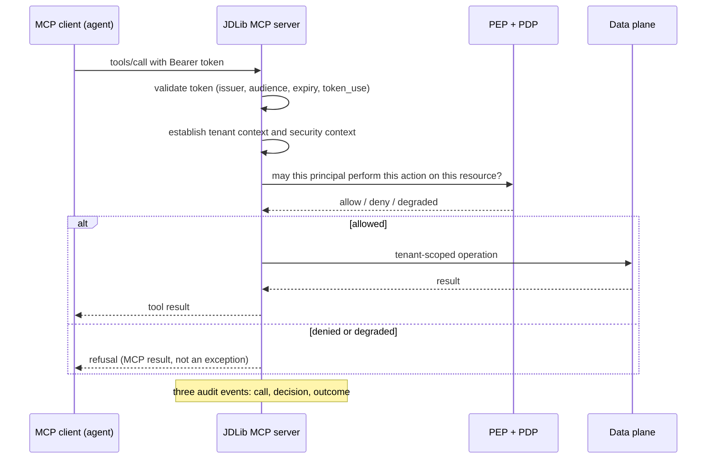

# The MCP authorization model, and where JDLib sits in it

> **Design authority:** [the AWS capability matrix](aws-capability-matrix.md),
> [the research sources](research-sources.md), and the library's own
> [MCP integration](../../integrations/mcp.md) page. Directive section 25.

## The model

MCP's authorization model is OAuth 2.1 with the MCP server as a **resource server**: the client gets
a token from an authorization server, presents it, and the server validates it. Three rules from that
model have direct consequences for this library:

1. **The token must be issued for the resource server.** A resource server must validate that the
   token's audience is itself — resource indicators (RFC 8707) exist so a client can ask for a token
   scoped to one server.
2. **Token passthrough is forbidden.** An MCP server must not accept a token it did not validate, and
   must not forward a client's token to an upstream API as its own credential. The stated reason is
   the confused-deputy and token-theft risks: a token minted for one audience, replayed at another,
   is a token the second service cannot reason about.
3. **Scopes gate the surface; they are not the permission model.** A scope says a client may call a
   class of operations. It does not know which resource, which tenant, or which principal.

## Where the library already complies

| Rule | How JDLib satisfies it |
| --- | --- |
| Audience validation | the generic JWT validator checks the audience claim; the [Cognito adapter](authentication-cognito.md) adds the `token_use` and `client_id` checks Cognito requires |
| No passthrough | the library never forwards a caller's token: outbound calls use the workload's own credentials, and the tenant context — not a token — carries the identity downstream |
| Scopes are not permissions | scopes are checked where they are checked anywhere else (authentication and surface gating); the decision is the PEP's, then the PDP's |
| Deny by default | a tool call without an allowed decision never enters the tool body |

The second row is worth dwelling on, because passthrough is the easy mistake: a tool that needs to
call an upstream API with the *user's* authority is a delegation problem, and the library's answer is
that the upstream call is made under the workload's identity with an explicit tenant scope — never by
relaying the caller's bearer token to a third party that did not issue it.

## The decision chain for a tool call

## The open question this page will not paper over

**Who is the principal when an agent acts for a user?** The library authorizes the principal the
validated token names. If the token names the agent, the agent's permissions are what the policy
engine sees, and a user cannot be given narrower or wider authority through that agent without a
delegation model. Two honest options:

* **Authorize the agent**, with permissions scoped to what the agent should be able to do, and treat
  the user's identity as context (an attribute, not the principal). Simple, auditable, and it means
  the agent is a first-class principal in the policy store.
* **Authorize the user**, by having the authorization server issue a token whose subject is the user
  and whose audience is the MCP server, with the agent's identity as a claim. This preserves the
  user's own permissions but requires the delegation to be explicit in the token and understood by
  the policy store's schema.

The library supports either, because it authorizes what the token says. What it will not do is guess,
and a deployment that has not decided is a deployment whose agent permissions are accidental.

## AWS specifics

* **AgentCore Gateway in authenticate-only mode** is the cleanest fit: it validates and forwards, and
  the library makes the decision ([the AgentCore page](agentcore.md)).
* **Cognito as the authorization server** works, with the caveat that Cognito's scopes are coarse:
  the resource server must still validate the audience, and the policy store still makes the
  resource-level decision.
* **Verified Permissions as the decision point** fits the MCP model directly, since the decision is
  asked per call with a principal, an action and a resource
  ([the Verified Permissions page](authorization-verified-permissions.md)).
