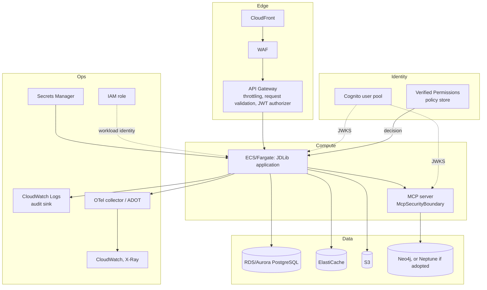
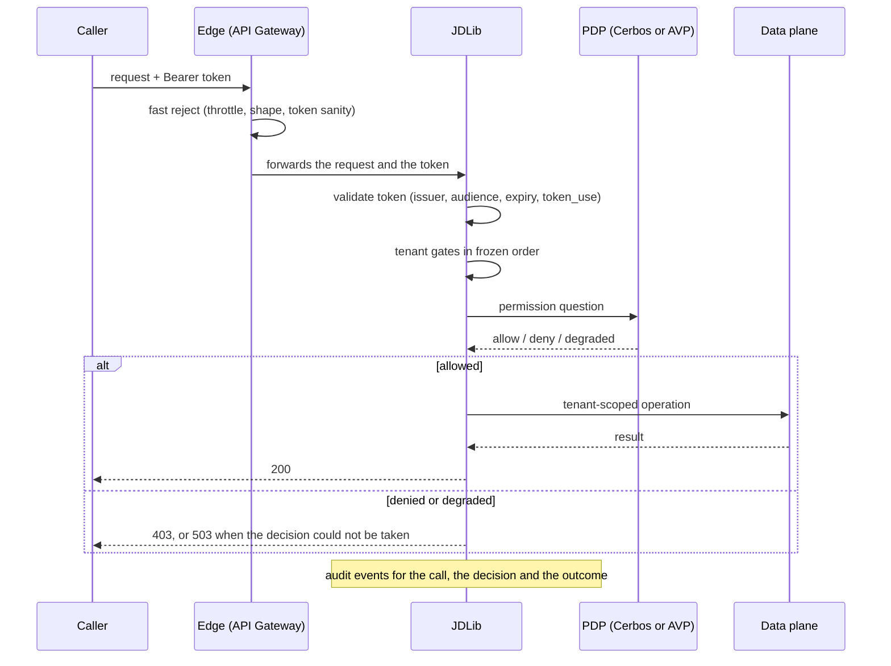
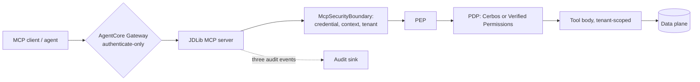
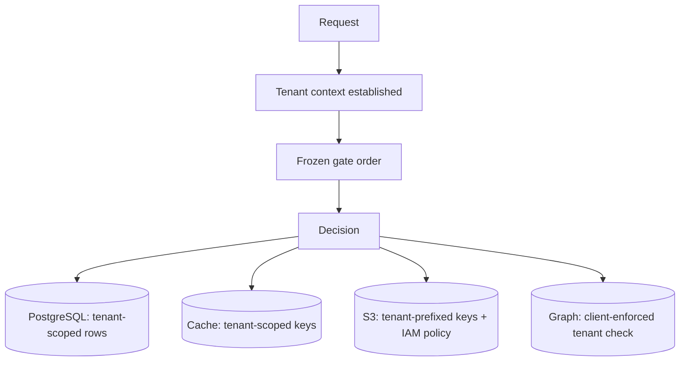

# Reference architectures

> **Design authority:** [the capability matrix](aws-capability-matrix.md) and
> [the research sources](research-sources.md). Directive section 33: the AWS deployment shapes this
> programme validated, drawn so the boundaries are visible rather than described.

## The full deployment

Read the arrows as trust boundaries: the edge rejects cheaply, the application authenticates and
decides, and no arrow skips the decision point.

## The decision chain for one request

## The MCP path

The gateway authenticates; the library decides. Moving the second step into the gateway is not
possible, because it has no knowledge of tenants, resources or the permission model — which is the
conclusion [the AgentCore page](agentcore.md) reaches from the other direction.

## The tenancy path through the data planes

Each data plane enforces tenancy differently, and the pages say which mechanism each one actually
uses rather than assuming they are equivalent: row scoping and the client's statement check are
enforcement, while an S3 prefix is a convention that IAM turns into a control.
