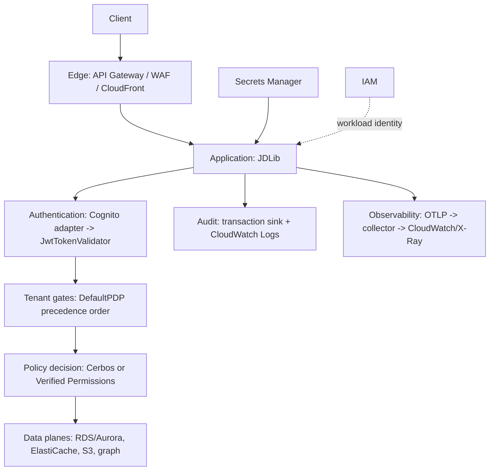

# The AWS security model, end to end

> **Design authority:** [the AWS capability matrix](aws-capability-matrix.md) and
> [the research sources](research-sources.md). This page assembles the programme's conclusions into
> one picture: which layer decides what, and where each AWS service sits.

## The layers

## What each layer decides

| Layer | Decides | Never decides |
| --- | --- | --- |
| Edge (API Gateway, WAF) | whether a request reaches the application at all; rate limits; request shape | application authorization, tenant isolation |
| Authentication (Cognito) | who the caller is | what they may do |
| Tenant gates (`DefaultPDP`) | principal active, tenant active, membership active, binding validity — in that frozen order | permission (it hands that to the policy engine) |
| Policy decision (Cerbos / Verified Permissions) | whether this principal has this permission on this resource | tenancy, identity, or anything outside the question asked |
| IAM | which AWS resources the workload may touch | anything about the application's users |
| Audit | — (it records; it does not decide) | — |

## The invariants this programme held

1. **A decision that cannot be made is a denial.** Every failure in every adapter — unreachable,
   timeout, throttled, malformed — produces a degraded denial, and `AuthorizationDecision` refuses
   to construct an allowed degraded decision at all. This is a property of the type, not the
   discipline of the adapter author.
2. **The decision point does not move.** Not to the edge, not to IAM, not into a gateway plugin. A
   gateway can reject cheaply; only the application can answer whether *this* principal may touch
   *that* tenant's data.
3. **No secret material outside the secret store.** No values in decisions, reprs, exception
   messages, cause chains or tracebacks — enforced by tests that assert it.
4. **Adapters conform to existing protocols.** Nine abstractions already existed; four adapters were
   written against them (Cognito, Verified Permissions, Secrets Manager, CloudWatch Logs) and
   nothing above the protocol changed.
5. **A missing abstraction is not invented to fill a matrix row.** Parameter Store, Neptune and
   messaging are classified with their reasons rather than implemented against interfaces that do
   not exist.

## Shared responsibility, stated correctly

AWS secures the cloud — the physical layer, the managed service's own availability and patching, the
encryption primitives. The deployment secures what it puts in it: identity configuration, policy
content, tenant isolation, secret handling, audit retention, and the decision to trust a token. The
library's part is the application layer's correctness, and its contribution to that is refusing to
be fail-open anywhere.

## Where an incident is investigated

* **Which AWS API was called** — CloudTrail.
* **Which application decisions were made, and why** — the audit sink, with the decision's reason and
  the policy that produced it.
* **What the system was doing at the time** — traces and metrics through the collector, correlated by
  trace id.
* **Whether it was identity, tenancy or policy** — the layers above, in that order, because that is
  the order in which a request passes through them.
