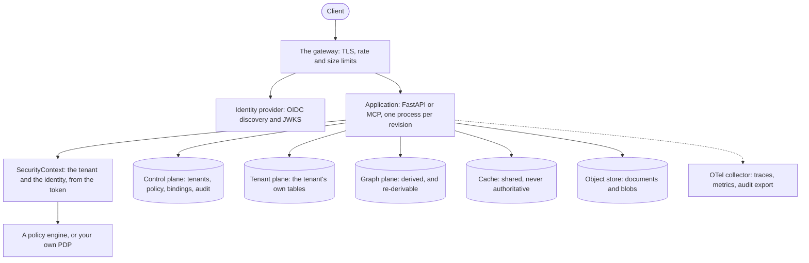

# Deployment

The shape of a deployment, in the order the steps have to happen. The
[operations authority](../operations/README.md) is the long form; this page is the sequence.

The topology those steps produce:



## 1. Provision the infrastructure

| Component | Why it is there | If it is missing |
|---|---|---|
| PostgreSQL (owner + application roles) | the control plane and the tenant plane | nothing works |
| a policy engine (or your own PDP) | the authorization decision | every decision is degraded, and a degraded decision is a refusal |
| an identity provider | OIDC verification | API keys still work; OIDC does not |
| Neo4j | the derived graph plane | the graph operations are refused; the relational path is unaffected |
| Redis | a shared cache | the in-process provider still works; each worker has its own |
| an object store | documents and blobs | the storage operations are refused |
| an OTel collector | traces and metrics | the request path is unaffected; the evidence is thinner |

## 2. Migrate and provision

```bash
jdlib db upgrade-control --database-url "$JDLIB_CONTROL_DSN"
jdlib tenant create --slug acme --name "Acme Inc" --strategy shared --target-handle default
jdlib tenant provision <tenant-id>
jdlib rls verify --database-url "$JDLIB_CONTROL_DSN" --schema tenant_acme
```

These are operator steps, not process start: a process that migrates on startup does it on every
worker, and a provisioning step that a restart retries is the failure the split avoids.

## 3. Serve

```bash
uvicorn myapp.asgi:app --host 0.0.0.0 --port 8000
```

The application composes the library once (`install(...)`) and declares its routes' permissions.

## 4. Deploy the next revision

1. readiness flips first (`/readyz` not-ready) so the balancer stops sending new work;
2. in-flight work finishes, bounded by the coordinator's deadline (`jdlib.reliability.lifecycle`);
3. the process exits with a `ShutdownReport` that says what completed.

A rolling deploy that reports abandoned work dropped requests, and the report is where that is
visible.

## The environment

Configuration comes from `JDLIB_*` variables (`TenancyConfig`), and secrets come from the
deployment's own provider chain — the library never reads a file it was not handed. The full list is
the [configuration reference](../reference/configuration-reference.md).

## The pre-flight check

* the application connects as `JDLIB_RLS__APP_ROLE`, not the owner;
* `jdlib rls verify` passes for every tenant schema;
* `JDLIB_CONTEXT__SIGNING_KEY` is set, per deployment, and rotated deliberately;
* breakers, the retry budget and the concurrency gate have values chosen for this deployment's
  capacity rather than left at a default;
* `/healthz` and `/readyz` are wired to the orchestrator's two probes, not to the same one;
* the audit sink is reachable and its failure metric is on a dashboard.
